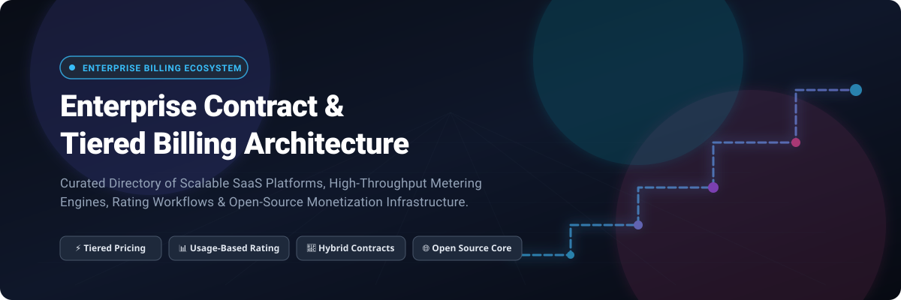

  

# 💳 Awesome Enterprise Contract & Tiered Billing

  
  
  
  
  
  

---

## 🚀 Overview

> **A curated collection of enterprise contract billing engines, tiered pricing architectures, multi-dimensional usage metering systems, and open-source monetization infrastructure.**

Whether you are designing **stairstep models, graduated volume pricing, minimum spend commitments, overage rating, or multi-tenant entitlement controls**, this repository catalogs industry-standard **SaaS enterprise solutions** alongside production-ready **open-source billing frameworks**.

---

## 📑 Table of Contents

- [📊 Sector Overview & Market Dynamics](#-sector-overview--market-dynamics)
- [🏢 SaaS & Hosted Enterprise Billing Platforms](#-saas--hosted-enterprise-billing-platforms)
- [💻 Open-Source Billing & Metering Projects](#-open-source-billing--metering-projects)
- [🏗️ Architectural Considerations & Design Patterns](#️-architectural-considerations--design-patterns)
- [🤝 How to Contribute](#-how-to-contribute)
- [💖 Support](#-support)
- [📈 Star History](#-star-history)
- [⚖️ Disclaimer](#️-disclaimer)

---

## 📊 Sector Overview & Market Dynamics

The global **subscription, recurring billing, and usage-based monetization software market** is valued at approximately **$8.0B to $9.2B in 2026** and is projected to expand to over **$20B by 2030**, recording a compound annual growth rate (CAGR) of **~14%–17%**. 

The sector is **moderately fragmented**: entrenched telecom and legacy enterprise incumbents (such as Amdocs and CSG) dominate massive telco/utility contracts, while specialized SaaS recurring billing leaders (such as Zuora, Chargebee, and Aria Systems) manage mid-to-large enterprise scale. Simultaneously, rapid adoption of hybrid consumption models and AI-driven API usage has opened high-velocity demand for modular, developer-first, and open-source rating engines (such as OpenMeter and Lago), preventing a pure "winner-take-all" outcome.

---

## 🏢 SaaS & Hosted Enterprise Billing Platforms

The table below outlines established enterprise billing providers sorted in descending order by **Company Scale (Annual Revenue / Enterprise Valuation)**.

| Product | Scale (Revenue / Valuation) | Description | Starting Pricing (Specific Tier) | Free Tier / Trial Limit |
|---|---|---|---|---|
| **[Amdocs](https://www.amdocs.com/)** | **~$4.70B ARR** / ~$4.7B Market Cap (NASDAQ: DOX) | Enterprise customer experience and monetization suite (**ConnectX**). Powers massive multi-play telecom operations, complex tiered pricing, volume commitments, and SLA billing. | Quote-only; custom enterprise baseline with typical entry engagements starting at **$100,000+/year** | **No free tier**; interactive sandbox & proof-of-concept provided strictly upon sales-qualified RFP/demo |
| **[Chargebee](https://www.chargebee.com/)** | **$3.5B Valuation** / ~$200M+ ARR | Subscription and usage billing platform with native support for flat-fee, stairstep, volume-tiered, and seat-based enterprise models with multi-entity support. | **$599/month** (Starter tier; billed annually at $7,188/year, includes up to $100K/month in billing volume; 0.75% overage) | **Free Starter Plan**: **$0 forever** for up to **$225,000 cumulative lifetime billing volume** (0.75% thereafter); 14-day free trial on premium tiers |
| **[CSG International](https://www.csgi.com/)** | **~$1.22B ARR** / ~$2.35B Acquisition Valuation (NEC) | Cloud-native revenue management and digital monetization platform supporting hybrid consumption, dynamic rating, B2B2X multi-party settlement, and wholesale billing. | Quote-only; multi-year enterprise contracts typically starting at **$50,000+/year** for modular cloud instances | **No free tier**; guided enterprise demo and sandbox environment upon qualification |
| **[Zuora](https://www.zuora.com/)** | **~$1.7B Buyout Valuation** (Silver Lake) / ~$415M ARR | The industry standard for enterprise subscription order-to-cash, consumption billing, automated revenue recognition (Zuora Revenue / ASC 606), and CPQ. | Quote-only; typical entry-level implementation packages start at **~$75,000/year** across Growth & Enterprise editions | **No forever-free tier**; tailored developer test sandbox and AI monetization pilot environments provided on request via sales |
| **[Aria Systems](https://www.ariasystems.com/)** | **~$150M–$250M Est. Valuation** / ~$50M+ ARR | Cloud recurring revenue and monetization platform optimized for enterprise environments requiring multi-dimensional billing, account hierarchies, and automated dunning. | Quote-only; bespoke multi-year enterprise contracts typically starting at **~$60,000/year** | **No free tier**; guided RFP-driven evaluation and private sandbox provisioning via sales engagement |
| **[Gotransverse](https://www.gotransverse.com/)** | **~$10M ARR** / ~$70M Total Funding | High-throughput usage rating and subscription engine specializing in complex usage-based pricing, dynamic tiers, and real-time mediation at high volume. | Quote-only; minimum starting tiers historically begin around **~$1,000/month ($12,000/year)** for specialized usage workloads | **No forever-free tier**; **30-day developer-friendly sandbox trial** available upon sales request |

---

## 💻 Open-Source Billing & Metering Projects

Self-hosted, transparent, and API-first monetization infrastructure. Sorted by **GitHub Star Count (Descending)**.

| Project | Stars Badge | License | Description |
|---|---|---|---|
| **[Lago](https://github.com/getlago/lago)** |  | AGPL-3.0 | **Open-source metering and usage-based billing engine.** Provides modern subscription management, complex tiered rating, prepaid credits, overages, and payment orchestrations for AI and developer-first SaaS products. |
| **[Invoice Ninja](https://github.com/invoiceninja/invoiceninja)** |  | Elastic License 2.0 | **Popular open-source billing, invoicing, and payment processing suite.** Supports recurring billing, client portals, multi-currency accounting, and payment gateway integrations. |
| **[Crater](https://github.com/crater-invoice-inc/crater)** |  | Open Source | **Open-source invoice and billing software for freelancers and small enterprises.** Complete tracking of payments, estimates, invoices, and comprehensive tax calculations. |
| **[Flexprice](https://github.com/flexprice/flexprice)** |  | Apache-2.0 | **Open-source pricing and billing infrastructure.** Tailored for AI agents and usage-first models with real-time metering, entitlement management, and custom pricing contracts. |
| **[Kill Bill](https://github.com/killbill/killbill)** |  | Apache-2.0 | **Enterprise-grade, distributed open-source subscription billing and payments platform.** Written in Java, battle-tested for high-scale multi-tenant architectures to prevent gateway lock-in. |
| **[OpenMeter](https://github.com/openmeterio/openmeter)** |  | Apache-2.0 | **CNCF Sandbox high-throughput metering & billing engine.** Built for cloud services, AI tokens, and streaming events. Supports graduated pricing tiers, package prices, and automated invoice lifecycle management. |

---

## 🏗️ Architectural Considerations & Design Patterns

When designing enterprise tiered and contract billing infrastructure, keep the following core concepts in mind:

1. **Volume vs. Graduated (Tiered) Pricing**:
   - *Volume Pricing*: The rate for all units consumed is determined by the final bracket reached.
   - *Graduated (Tiered) Pricing*: Units within each bracket are rated at that bracket's specific rate, creating a step function.
2. **Event Ingestion & Deduplication**:
   - High-velocity usage data (e.g., API requests, compute hours, AI tokens) must be metered idempotently with stream engines (e.g., Apache Kafka, ClickHouse) before routing to the rating engine.
3. **Proration & Mid-Cycle Upgrades**:
   - Enterprise contracts regularly amend mid-billing period. Systems must calculate sub-day proration across complex tier thresholds.
4. **Entitlements & Feature Flags**:
   - Decouple payment processing from live authorization. Use fast in-memory entitlement verification to prevent latency during customer runtime requests.

---

## 🤝 How to Contribute

Contributions, suggestions, and corrections are warmly welcomed! 💡

1. 🍴 **Fork the repository**
2. 🌿 **Create your feature branch** (`git checkout -b feature/add-new-billing-tool`)
3. 📝 **Commit your changes** (`git commit -m 'Add NewBillingTool to open-source list'`)
4. 🚀 **Push to the branch** (`git push origin feature/add-new-billing-tool`)
5. 📬 **Open a Pull Request** with clear details about the pricing model or repository credentials.

---

## 💖 Support

If you found this directory helpful for your billing architecture and research, please consider supporting the project:

- ⭐ **Star this repository** to help others discover it!
- 🍴 **Fork and share** with fellow developers and finance engineering teams.
- ☕ **Buy a coffee & sponsor**: Support further research and maintenance at the [Sponsor Dashboard](https://github.com/sponsors/ishandutta2007).

---

## 📈 Star History

---

## ⚖️ Disclaimer

- This curated list is maintained for educational and architectural reference only. It is not financial or legal advice.
- Financial transactions, tax compliance (e.g., Sales Tax, VAT, e-invoicing), and PCI DSS compliance require rigorous architectural reviews. Validate all tier boundary calculation logic, dunning, and currency conversion logic independently before production deployment.

---

  Maintained with ❤️ by <a href="https://github.com/ishandutta2007">Ishan Dutta</a>. Powered by the developer community.

